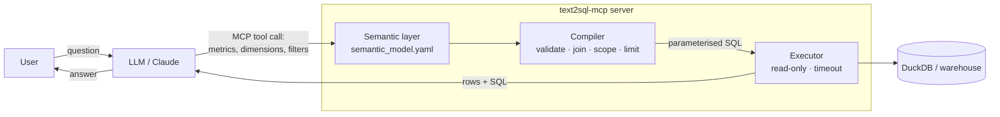

# text2sql-mcp

**Let an LLM answer analytics questions over your warehouse without letting it write SQL.**

An [MCP (Model Context Protocol)](https://modelcontextprotocol.io) server that gives Claude, or any MCP client, safe, read-only access to an analytics database through a **semantic layer**. The model asks for *metrics, dimensions and filters* by name; the server compiles validated, parameterised SQL, applies per-user row-level access, and runs it read-only.


> **Ask:** *"Which product category has the worst return rate this year, and is it getting worse?"*
>
> Claude calls `list_metrics_and_dimensions`, then
> `query(metrics=["return_rate"], dimensions=["category"], start_date="2026-01-01")`,
> then `query(metrics=["return_rate"], dimensions=["order_date"], filters=[{dimension:"category", op:"eq", value:"Fashion"}], time_grain="quarter")`,
> and answers from real numbers, showing the SQL it ran.

---

## Why a semantic layer instead of "LLM writes SQL"?

Free-form text-to-SQL looks great in demos and breaks in production:

| Problem with raw LLM SQL | How this server handles it |
|---|---|
| Hallucinated tables/columns | The LLM can only use names defined in `semantic_model.yaml`. Unknown names return *"Did you mean …?"* so the model corrects itself. |
| Inconsistent metric definitions ("revenue" computed 3 ways) | Each metric is defined **once**, in SQL, in the model. |
| SQL injection / destructive queries | Identifiers come only from the model; every user value is a bound parameter; the DB connection is **read-only** with external access disabled. |
| Users seeing data they shouldn't | Row-level scopes per user are appended by the compiler, never left to the prompt. |
| Runaway queries | Row limits clamped to `max_rows`, query timeout, truncation reported back to the model. |
| Wrong joins | Joins are declared once and added only when a requested dimension needs them. |

## Architecture



## Tools

| Tool | Purpose |
|---|---|
| `list_metrics_and_dimensions` | Discover the vocabulary (and the caller's access scope). |
| `get_dimension_values` | Look up valid filter values, e.g. countries matching "ind". |
| `query` | Run an aggregate query; returns columns, rows, truncation flag and the SQL. |
| `explain_query` | Return the SQL + parameters without executing (dry run). |

All tools are annotated `readOnlyHint: true`.

## Quickstart

Requires [uv](https://docs.astral.sh/uv/).

```bash
git clone https://github.com/pranjalgup/text-to-sql-mcp && cd text-to-sql-mcp
uv sync
uv run text2sql-seed      # creates data/shop.duckdb (2k customers, 60 products, 60k order lines)
uv run pytest             # 18 tests
```

**Claude Code**

```bash
claude mcp add text2sql -- uv --directory "$(pwd)" run text2sql-mcp
```

**Claude Desktop** (`claude_desktop_config.json`)

```json
{
  "mcpServers": {
    "text2sql": {
      "command": "uv",
      "args": ["--directory", "/absolute/path/to/text-to-sql-mcp", "run", "text2sql-mcp"]
    }
  }
}
```

Then ask: *"What's our average order value by customer segment?"* or *"Show monthly net revenue for 2026 by channel."*

### Configuration

| Env var | Default | Meaning |
|---|---|---|
| `TEXT2SQL_MODEL` | `semantic_model.yaml` | Semantic model to load |
| `TEXT2SQL_DB` | `data/shop.duckdb` | DuckDB database file |
| `TEXT2SQL_USER` | *(unset)* | Caller identity for row-level access (try `apac_analyst`) |
| `TEXT2SQL_TRANSPORT` | `stdio` | `stdio`, `sse` or `streamable-http` |

## Defining your own model

```yaml
metrics:
  avg_order_value:
    sql: SUM(o.quantity * o.unit_price) / NULLIF(COUNT(DISTINCT o.order_id), 0)
    description: Revenue divided by number of orders.

dimensions:
  region:
    sql: c.region
    join: customers          # join added only when this dimension is used
    description: Customer region (APAC, EMEA, NA, LATAM).

access:
  users:
    apac_analyst:
      region: [APAC]         # every query this user runs gets WHERE c.region IN ('APAC')
```

Point `TEXT2SQL_MODEL` at your file and `TEXT2SQL_DB` at your database. The compiler and tools need no code changes.

## Example: what the compiler produces

`query(metrics=["return_rate"], dimensions=["region"], filters=[{"dimension": "channel", "op": "in", "value": ["web","app"]}], start_date="2026-01-01")` as user `emea_manager`:

```sql
SELECT c.region AS region, AVG(CASE WHEN o.status = 'returned' THEN 1.0 ELSE 0.0 END) AS return_rate
FROM orders o
JOIN customers c ON o.customer_id = c.customer_id
WHERE o.channel IN (?, ?)
  AND o.order_date >= ?
  AND c.region IN (?)          -- row-level scope, always appended
  AND o.channel IN (?, ?)
GROUP BY c.region
ORDER BY return_rate DESC
LIMIT 101                      -- max rows + 1, to detect truncation
```

## Project layout

```
src/text2sql_mcp/
  semantic_layer.py   # load + validate the YAML model, "did you mean" errors
  compiler.py         # request -> parameterised SQL (joins, filters, scope, limits)
  executor.py         # read-only DuckDB execution with timeout
  server.py           # MCP tools
  seed.py             # deterministic synthetic dataset
semantic_model.yaml
tests/                # compiler unit tests + end-to-end MCP tool tests
```

## Roadmap

- [ ] Trino / Postgres executors behind the same interface
- [ ] Derived metrics (period-over-period, share-of-total)
- [ ] OAuth identity → access scope for remote (HTTP) deployments
- [ ] Evaluation set of natural-language questions with expected results

## License

MIT
